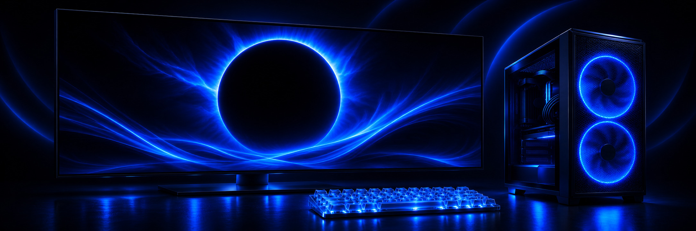

# PowerSpec G478 RGB on Linux · Blue Breathing



*Concept art inspired by the setup, with a 43-inch Samsung M70H Mini LED 4K TV.*

[Quick start](#quick-start) · [Troubleshooting](#troubleshooting) · [How I used Codex](#how-i-used-codex)

I wanted slow blue breathing across my setup, with no green and no Windows boot. This is what worked on my PowerSpec G478. The front fans and Zotac GPU are confirmed. The motherboard, keyboard, and mouse have the limits below.

## Quick start

Install Python 3 and [OpenRGB](https://openrgb.org/releases.html) for your distro. For the Zotac card, build [SpectraCtrl](https://github.com/Doodcom/SpectraCtrl) using its instructions and put the executable on your PATH or at `~/.local/bin/spectractl`. The script uses tools already installed. It does not install packages or start a background service.

```sh
python3 blue-breathing.py          # check what the controllers report
python3 blue-breathing.py --apply  # send blue breathing to the GPU and MSI board
```

The apply command exits with status 1 if either controller fails to report the requested mode or if the GPU fails to report blue. A successful exit does not verify the physical LEDs or synchronize their timing.

| Hardware | What worked |
| --- | --- |
| Zotac RTX 4080 SUPER Trinity Black | SpectraCtrl identified controller `N702E-1002`. The saved color was blue, but LED power was off. `spectractl on` restored it. `spectractl mode breathe 0000FF 100` set blue breathing, confirmed by `spectractl status`. |
| PowerSpec / LANCOOL 206 front fans | Tap **M** until the whole blue ring dims and brightens together. A moving pattern that travels inward or outward is a different preset. Tap **C** to cycle to blue. If the rings are linked, use the inner pair. Otherwise use each ring's own pair. |
| MSI MPG Z790 EDGE WIFI | Rainbow Wave brought the lights back. OpenRGB continued to report Rainbow Wave after a blue Breathing command, so blue breathing on this board is unverified. If a change makes the board go dark, the recovery that worked here was selecting that board in OpenRGB and applying **Rainbow wave** without brightness or speed flags. Use `openrgb --list-devices` to get the current device number first. |
| Redragon ELF PRO K649 | Connect the USB cable and move the side switch to **OFF** for wired mode. The official K649 app opened under Wine. I confirmed solid blue using **Fixed_on**, the dark-blue square, and Save. For blue breathing, choose **Respire**, select dark blue, clear **Colourful**, and save. Check the physical keys while idle. Blue breathing was not independently verified. |
| [Samsung M70H 43-inch Mini LED 4K TV](https://www.samsung.com/us/tvs/mini-led-tv/43-inch-mini-led-4k-tv-m70h-sku-un43m70hafxza/) | The display is part of the setup and the artwork. Its settings are outside the scope of the RGB script. |
| SteelSeries Aerox 3 Wireless | OpenRGB exposed **Rainbow Breathing**, which includes green. The script leaves the mouse alone. |

[PowerSpec case button guide](https://community.microcenter.com/discussion/14124/powerspec-atx-206-chassis) · [Redragon K649 software](https://redragonshop.com/pages/software)

## Troubleshooting

### How do I set PowerSpec G478 front fans to blue breathing?

On the LANCOOL 206 front panel, tap **M** until both fan rings dim and brighten as a whole. Then tap **C** to cycle to blue. The two **M/C** pairs control the inner and outer rings separately unless they are linked. Hold both **M** buttons for about three seconds to toggle ring linking. When linked, use the inner pair.

### Why is my Zotac RTX 4080 SUPER RGB off on Linux?

If OpenRGB doesn't list the Zotac card, run `spectractl status`. For the Trinity Black card tested here, the controller reported `power: off`. Running `spectractl on` restored the light. Running `spectractl mode breathe 0000FF 100` then set blue breathing.

### Why is my Redragon ELF PRO K649 preview blue but the keys still react to typing?

Check the physical keyboard while idle. Use **Fixed_on** to test solid blue before switching to **Respire**. Select the dark-blue square under the color wheel and click Save. Connect the cable and set the side switch to **OFF** to use wired mode with the Redragon app.

## How I used Codex

I told Codex what I could see on the actual hardware. It checked which controllers Linux could see and read back the settings after each change. That mattered because an OpenRGB command could exit successfully while the MSI controller still reported the old effect, and the Redragon app could show a blue preview while the physical keys were still in Reaction mode.

Codex found the Linux tool that could reach my Zotac card, read back that its lighting power was off, and turned it on. I handled the case buttons and confirmed when the whole fan ring was fading together. Then I asked Codex to turn the working steps into one Linux script and write down the manual steps too.
